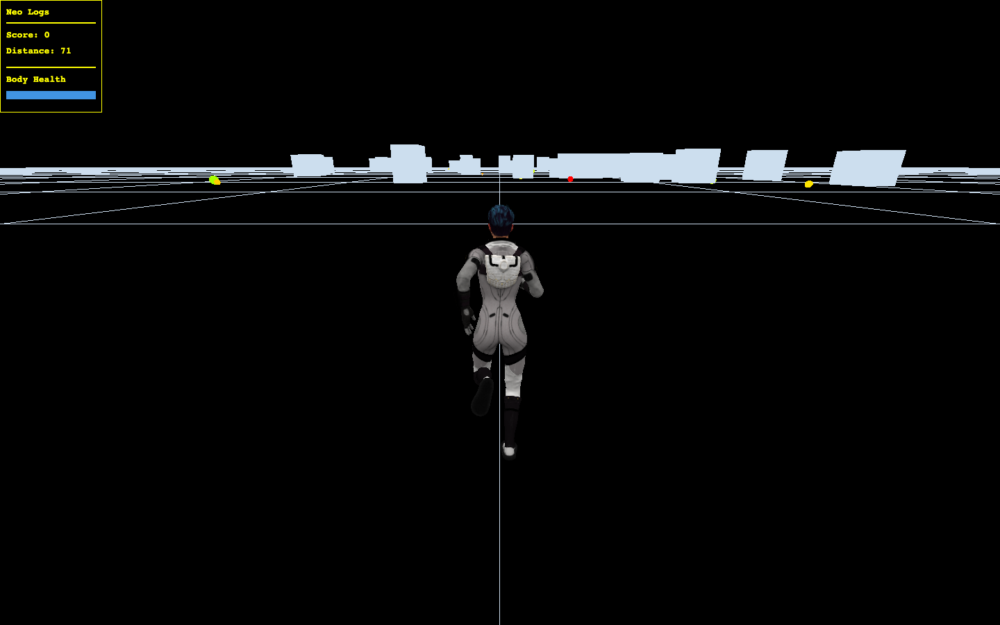
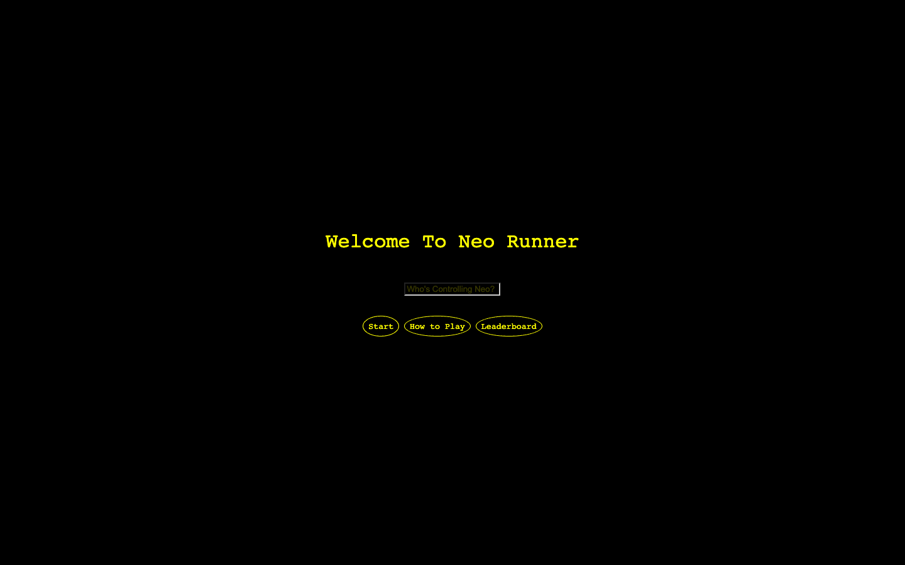

<div align="center">

# NEO RUNNER

**Keep moving. Chase the yellow. Beat the leaderboard.**

A browser-based 3D endless runner built with Three.js.
Dodge obstacles, collect bonuses, and keep Neo running as the world speeds up.

[**Play Neo Runner →**](https://neorunner.elijahschrock.com) · [Run locally](#run-locally) · [Deploy with Forge](deploy/forge.md)


</div>



## The game

A dark world, a moving grid, and a runner who never stops. Neo Runner pairs a
minimal arcade interface with an animated 3D character, sound effects, and a
soundtrack. Every run gets faster. Stay clear of obstacles, collect points,
and watch your health.

- **An endless challenge.** Survive an increasingly fast run while tracking score and distance.
- **Bonuses worth chasing.** Orange-to-yellow pickups award points; brighter yellow means more points. Red pickups restore health.
- **A shared top 10.** Compete across browsers with a persistent leaderboard, available from the welcome screen and after each run.
- **Desktop and touch controls.** Steer with the keyboard or use the on-screen mobile buttons.
- **Pause when you need to.** Resume your run or replay after game over.

<details>
<summary><strong>See the welcome screen</strong></summary>



Screenshots captured from the local application.

</details>

## How to play

Enter a name and select **Start**. You begin with **50 health**; each obstacle
hit costs **10 health**. Red pickups restore **10 health**, up to the starting
maximum. Collect orange and yellow bonuses for **5–20 points** each.

| Action | Keyboard | Touch |
| --- | --- | --- |
| Steer left | ← | Left |
| Steer right | → | Right |
| Pause | ↑ | Pause |
| Resume | ↓ or Continue | Continue |

Select **Leaderboard** on the welcome screen to see the current top runs before
playing. Rankings use score first, then distance to break ties.

## Run locally

**You need:** Node.js **24 or newer**, npm, and a browser with WebGL enabled.
All game assets are included. The app creates its SQLite database automatically.

```sh
git clone https://github.com/ElijahSchrock/Neo-Runner.git
cd Neo-Runner
npm ci
npm start
```

Open **[http://127.0.0.1:5173](http://127.0.0.1:5173)**.
Leave the terminal running; press **Ctrl+C** to stop the server.

If you use NVM, run `nvm install` and `nvm use` inside the project before
installing dependencies. The included `.nvmrc` selects Node 24.

> The game loads a texture-optimized character model for lower memory use on
> phones. The original model is kept as source material.

### Useful commands

| Command | Purpose |
| --- | --- |
| `npm start` | Run the game and leaderboard API locally, with live frontend updates |
| `npm run dev` | Same as `npm start` |
| `npm run optimize:model` | Regenerate the mobile-friendly character model from the original |
| `npm test` | Check database persistence, ranking, API validation, and request limits |
| `npm run build` | Generate the production frontend in `dist/` |
| `npm run serve` | Serve the production frontend and API together |
| `npm run preview` | Preview only the built frontend; does not include the leaderboard API |

## Under the hood

| Layer | Technology |
| --- | --- |
| 3D scene, character animation, rendering | Three.js + GLTFLoader |
| Music and sound effects | Howler.js |
| Interface | HTML, CSS, JavaScript |
| Frontend development and build | Vite |
| API and production server | Node.js + Express |
| Persistent scores | SQLite through Node's built-in `node:sqlite` module |

The browser runs the game. A small API saves scores to a SQLite file and returns
the top 10 runs. Development uses one local server for both; production can put
Nginx in front of the API and serve the built frontend directly.

```text
Neo-Runner/
├── index.html             # Welcome screen, game UI, and leaderboard
├── main.js                # Renderer, camera, lights, and animation loop
├── game.js                # Gameplay, controls, audio, and score display
├── style.css              # Arcade UI and responsive layout
├── public/assets/         # Character model, music, and sound effects
├── server.mjs             # Development and production server entry point
├── server/leaderboard.mjs # SQLite storage and API routes
├── test/                  # Database and API checks
├── deploy/forge.md        # DigitalOcean / Laravel Forge walkthrough
├── docs/images/           # README screenshots
└── .env.example           # Optional configuration template
```

### Leaderboard API

| Method | Route | Purpose |
| --- | --- | --- |
| `GET` | `/api/health` | Check API and database availability |
| `GET` | `/api/leaderboard` | Read the top 10 runs |
| `POST` | `/api/leaderboard` | Submit a run and receive the updated top 10 |

Names can contain up to 40 characters. Scores and distances must be nonnegative
integers, up to one billion. The server generates timestamps and limits score
submissions to 20 per minute per client IP. Names are rendered as text.

This is a casual leaderboard: runs are submitted by the browser, and names are
not authenticated. Scores are shared, but they are not proof of a verified run.

## Configuration

**No environment file is required for local play.** To customize settings:

```sh
cp .env.example .env.local
```

| Variable | Default | Purpose |
| --- | --- | --- |
| `HOST` | `127.0.0.1` | Address the Node server listens on |
| `PORT` | `5173` in development; `3000` in production | Node server port |
| `DATABASE_PATH` | `data/neo-runner.sqlite` | SQLite database file location |
| `VITE_ASSET_BASE_URL` | `/assets` | Public directory URL for game assets |

Local and production npm server commands load `.env.local` when it exists.
Process environment variables take precedence over that file. Restart the
server after changing server settings. Asset URL changes also require a rebuild
for production.

### Assets and DigitalOcean Spaces

The model and audio live in `public/assets/` and are copied into the production
build. To serve them from Spaces or a CDN instead, set the public directory URL:

```dotenv
VITE_ASSET_BASE_URL=https://your-space.your-region.cdn.digitaloceanspaces.com
```

That directory must contain:

```text
Neo-optimized.glb
background-music.mp3
obst-hit-option2.wav
bonus-7.wav
health-bonus.wav
```

Allow public reads and cross-origin requests from the game's origin. Variables
prefixed with `VITE_` are bundled into browser code: use a **public URL**, never
Spaces access keys or secrets.

### Character model optimization

The game loads `Neo-optimized.glb`. Regenerate it with `npm run optimize:model`
after changing the original `public/assets/Neo.glb`. The script resizes textures
to at most 1024×1024 while preserving the character geometry and animations.
Commit the generated model so deployment does not need to regenerate it.
If using Spaces, upload `Neo-optimized.glb` alongside the audio files.

### Database storage

The database and schema are created on first start. There is no separate SQL
service to install. Database files, environment files, and generated builds are
excluded from git.

For deployment, set `DATABASE_PATH` to persistent storage **outside the checkout**
so deployments preserve scores. Back it up with SQLite's backup tools; copying
only the main database file while it is running can miss data in its WAL file.
The Forge guide includes backup instructions.

## Deploy

To check the complete production app locally:

```sh
npm run build
npm run serve
```

Open **[http://127.0.0.1:3000](http://127.0.0.1:3000)**.

For **DigitalOcean + Laravel Forge**, follow the
[step-by-step deployment guide](deploy/forge.md). It covers DNS, Node 24,
builds, persistent database storage, the background process, Nginx routing,
and HTTPS for `neorunner.elijahschrock.com`.

The frontend is static, but the shared leaderboard needs the Node process.
Deploying only `dist/` will not provide the leaderboard API. After backend
changes, restart the app's Forge background process following deployment.

## Troubleshooting

| Symptom | What to check |
| --- | --- |
| Loading screen stays visible | Let the large model finish downloading; check the browser's Network tab for failed model requests |
| Assets fail after switching to Spaces | Check the public URL, file names, read permissions, and CORS; restart or rebuild after changing the URL |
| Game works but scores do not load or save | Check `/api/health`; confirm the Node process is running and Nginx forwards `/api/` to its port |
| Production server reports a missing build | Run `npm run build` before `npm run serve` |
| Node or SQLite import errors | Confirm the server and background process both use Node 24 or newer |

---

Created by [Elijah Schrock](https://github.com/ElijahSchrock).
